# RAG-Based Customer Support Email Agent

An n8n workflow that retrieves relevant information from an e-commerce support knowledge base and uses it to draft an email response grounded in that context. If the retrieval step does not find usable knowledge, the workflow sends a fallback reply asking the customer support team to review the issue.

## Project overview

This workflow has two paths:

1. **Knowledge-base ingestion (manual trigger):** find a Google Drive folder, list its documents, download each document, create embeddings, and insert the documents into a Pinecone vector index.
2. **Incoming customer email (Gmail trigger):** read the email, retrieve relevant knowledge from Pinecone, check whether context was found, then either generate a context-grounded HTML response with GPT-4o-mini and send it, or send a fallback response.

> **Important:** This is an exported n8n workflow template. It has not been executed or independently tested in this environment. Connect your own services and test with a dedicated mailbox before production use.

## Key features

- Gmail trigger configured to poll every minute.
- Extracts sender name, sender email, subject, snippet, message ID, and thread ID.
- Uses Pinecone as the vector store for support knowledge.
- Uses OpenAI embeddings with a configured dimension of 512 in the exported workflow.
- Uses GPT-4o-mini for response generation.
- Instructs the agent to answer using only retrieved knowledge and not invent unsupported information.
- Checks for retrieved knowledge and sends a predefined fallback reply when context is missing.
- Formats the generated email body as HTML.

## Workflow architecture

```mermaid
flowchart TD
    subgraph INGEST[Knowledge Base Ingestion - Manual]
        A[Manual Trigger] --> B[Find Knowledge Base Folder in Google Drive]
        B --> C[List Knowledge Base Documents]
        C --> D[Download Each Document]
        D --> E[Load Document + OpenAI Embeddings]
        E --> F[Insert Vectors into Pinecone]
    end

    subgraph EMAIL[Customer Email Handling - Gmail Trigger]
        G[Gmail Trigger: every minute] --> H[Extract Sender and Email Fields]
        H --> I[Prepare Customer Query]
        I --> J[Retrieve Relevant Knowledge from Pinecone]
        J --> K[Aggregate Retrieved Context]
        K --> L{Knowledge Context Found?}
        L -- Yes --> M[AI Agent: GPT-4o-mini]
        M --> N[Send Context-Grounded HTML Reply]
        L -- No --> O[Send Fallback Reply]
    end
```



Editable Mermaid source: [`docs/workflow-diagram.mmd`](docs/workflow-diagram.mmd)

## Technology stack

- n8n
- Gmail
- Google Drive
- OpenAI embeddings
- OpenAI GPT-4o-mini
- Pinecone vector database
- Retrieval-augmented generation (RAG)

## Business use case

E-commerce support teams receive recurring questions about shipping, returns, product details, orders, and policies. Staff may spend time searching documentation and composing similar replies.

This workflow is designed to retrieve relevant support content and generate a consistent first response. When the retrieved knowledge is insufficient, it uses a fallback response rather than asking the model to guess. Human support review is still necessary for sensitive cases, policy exceptions, and questions that require account-specific data.

## Setup guide

### Prerequisites

- An n8n instance with the Google Drive, Gmail, Pinecone, OpenAI, and LangChain nodes available.
- Google Drive OAuth credentials with access to the knowledge-base folder.
- Gmail OAuth credentials for the support mailbox.
- OpenAI API credentials for embeddings and chat completion.
- A Pinecone account and an index compatible with the configured embedding dimensions.
- A folder named `Ecommerce_Customer_Support_Knowledge_Base` containing the support documents you want to index.

### Import and configure

1. Import `workflow/rag-customer-support-agent.template.json` into a **test** n8n workspace.
2. Reconnect your own Google Drive, Gmail, OpenAI, and Pinecone credentials to the relevant nodes.
3. In **Find Knowledge Base Folder**, confirm the folder name matches your Drive folder.
4. In the Pinecone nodes, select your own index. The exported workflow uses an embedding dimension of `512`; ensure the selected index and embedding model are compatible.
5. Confirm the knowledge-base documents are supported by the configured default data loader. Add document-specific extraction/conversion steps if needed.
6. Run the manual ingestion branch and inspect each node's output. Confirm documents are inserted into Pinecone without duplication or indexing errors.
7. Configure the Gmail trigger to use a test mailbox or a tightly scoped test filter.
8. Test both retrieval outcomes: a question clearly answered by the knowledge base and a question not covered by it.
9. Verify the actual email recipients, HTML formatting, subject, thread behavior, and fallback behavior.
10. Only activate the production workflow after all tests pass and the support team approves the content.

## Example customer email

```text
From: Jamie Lee <jamie@example.com>
Subject: What is your return policy?
Message: Could you tell me how many days I have to return an item?
```

The Gmail trigger in the export passes `snippet` into `customer_message`. A snippet may not contain the full email body. If full-message handling is required, add a Gmail message-fetch step and map the full body into the query.

## Illustrative response shape

The AI Agent is instructed to return only an HTML email body, with a greeting and a fixed closing. The following is a **format example only**, not a captured workflow execution:

```html
<p>Hi Jamie,</p>
<p>According to our support documentation, [insert verified policy detail from retrieved knowledge].</p>
<p>Best regards,<br>
Customer Support Team</p>
```

Never publish fabricated output as proof of a successful run. Replace the illustrative content with a sanitized, real execution result after testing.

## Output and evidence

Capture these artifacts from actual test executions:

1. n8n execution showing the Gmail-trigger path.
2. Pinecone retrieval output with relevant context (redact customer data).
3. The generated HTML reply before sending.
4. The received test email in the dedicated test inbox.
5. The fallback reply when the query cannot be answered from the knowledge base.
6. The ingestion branch showing documents successfully indexed.

Screenshots should hide customer email addresses, message contents that contain personal information, API keys, private Drive URLs, and account identifiers. See [`screenshots/README.md`](screenshots/README.md).

## Test plan

See [`docs/test-plan.md`](docs/test-plan.md). Test at least:
- a question directly answered by a knowledge-base document;
- a question partially answered by the knowledge base;
- a question with no relevant retrieved context;
- a malformed or empty document;
- a Gmail message with a missing sender name;
- a message where `snippet` is too short or incomplete;
- OpenAI, Pinecone, Google Drive, and Gmail credential failures;
- duplicate ingestion runs;
- a sensitive question that should be escalated rather than answered automatically.

## Business impact measurement

Potential benefits include reducing repeated manual searches, standardizing routine replies, and directing unsupported questions to human review. No time-saving or accuracy figures are claimed because no measured execution data was supplied.

For a pilot, track:
- average time spent finding policy information and writing a reply before and after automation;
- percentage of replies accepted by support staff without edits;
- answer-grounding accuracy against the knowledge base;
- fallback rate;
- incorrect or unsupported answer rate;
- email delivery failure rate;
- duplicate or repeated responses;
- human escalation rate.

Measure a representative sample and disclose the sample size and period before making numerical claims.

## Review findings and production checks

These points are based on inspection of the exported JSON, not a live execution.

1. **The ingestion branch is manual.** Newly added or updated documents are not automatically re-indexed unless the ingestion workflow is run again or a separate scheduled/file-change trigger is added.
2. **Snippet-only query:** `customer_message` is mapped from Gmail `snippet`, which may omit important parts of longer emails. Fetch and use the full message body if needed.
3. **Fallback condition:** the IF node checks `$json.knowledge_context[0]`. Verify the Aggregate node's actual output shape during execution; adjust the expression if `knowledge_context` is a string, empty array, or differently structured value.
4. **Embedding/index compatibility:** the export sets embedding dimensions to `512`. Confirm that the selected embedding model and Pinecone index use matching dimensions and compatible configuration.
5. **Email sending is automatic:** the success and fallback paths use Gmail actions to send replies. Start with a test inbox and add approval/human review before enabling automatic replies to customers.
6. **Email recipient mapping:** the send node maps `sendTo` to the raw Gmail `From` value. Verify that this format is accepted by the Gmail node and that replies go only to the intended sender. `replyToSenderOnly` is set to `false`; review this setting carefully to avoid unintended recipients.
7. **Knowledge ingestion robustness:** confirm the Google Drive query returns the intended folder and only the expected documents. Test folders containing multiple files and unsupported formats.
8. **Prompt typo:** the AI Agent prompt contains “End with next paragrap:” before the closing-format instructions. It should be cleaned up for clarity.
9. **Error handling:** add explicit handling for failed retrieval, model errors, and failed Gmail sends, with logging and a safe retry strategy.
10. **Privacy and retention:** support emails may contain personal data. Minimize stored data, restrict access, and review retention policies for Google Drive, OpenAI, and Pinecone.

## Repository structure

```text
.
├── README.md
├── workflow/
│   └── rag-customer-support-agent.template.json
├── docs/
│   ├── workflow-diagram.mmd
│   ├── test-plan.md
│   └── demo-script.md
├── examples/
│   └── sample-customer-email.txt
└── screenshots/
    └── README.md
```

## License

Choose a license after confirming you have permission to publish the workflow and any included content. Do not commit credentials, customer emails, private support documents, or production identifiers.
